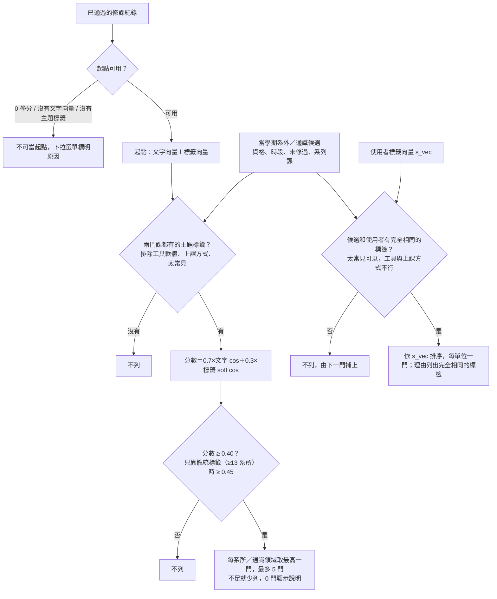

# 探索頁主題門檻：停用「共同用詞」、要求相同主題與最低分數（ADR-033）

日期：2026-11-23

## 背景

D1249697 的逐課檢查（[報告](./2026-11-23-explore-page-audit-D1249697.md)）發現「從一門課出發」兩種比較方式都會推出不相干的課：

- 「共同用詞」（字元 bigram TF-IDF）沒有下限，中位數相似度 0.048，靠「網站」「理學」「結構」等片段湊滿 5 門。
- 「語意相似」七成只靠一個泛用或工具標籤入選（Python、系統設計、互動設計、Microsoft Teams）。
- 「依你的修課與興趣」偶爾列出只靠相近標籤表配到的課（例：全像原理與應用，靠「資訊科技≈資訊處理」）。

使用者決定（2026-11-23）：

1. 拿掉共同用詞，用「向量＋標籤」，門檻 0.40；先用 Persona 試算。
2. 工具軟體不當主題配對。
3. 「班級活動」不能當起點。
4. 籠統標籤保留，但只靠它配到時門檻提高為 0.45（方案 b）。
5. 「依你的修課與興趣」要求至少 1 個完全相同的標籤，不能只靠相近標籤。

## 資料流

## 修改檔案

| 檔案 | 內容 |
| --- | --- |
| `server/src/skills/explorationTagGate.js`（新增） | 標籤分四類（主題／太常見／工具軟體／上課方式）、標籤出現的系所數、籠統標籤門檻、修課輪廓的完全相同標籤 |
| `server/src/services/explorationService.js` | 「從一門課出發」只剩文字向量＋標籤，加入相同主題標籤與分數門檻；起點不可用原因改為 `zero-credit-course`／`no-text-embedding`／`no-course-tags`；移除 TF-IDF 索引；修課輪廓模式要求完全相同標籤，理由修正；通識沒有結果時分散說明不再誤顯示 |
| `server/src/skills/courseExploration.js` | 刪除 TF-IDF 斷詞、索引、cosine、共同字詞函式，只留 `rankSerendipitous`；`similarityOf` 改為必填 |
| `server/test/courseExploration.test.js` | 刪除 EX1／EX2／EX4，EX3 改用測試內的 cosine，新增門檻回 0 與缺 `similarityOf` 的案例 |
| `server/src/routes/exploration.js` | `representation` 預設改為省略（embedding），`tfidf` 回 400 |
| `client/src/pages/ExplorePage.jsx` | 移除「共同用詞／語意相似」切換；新的空狀態、起點不可用原因與方法說明文字 |
| `client/src/services/api.js` | 不再傳 `representation` |
| `server/test/explorationService.test.js` | 改用注入的文字向量與主題標籤；新增 0 學分起點、tfidf 400、工具／上課方式標籤、0.40／0.45 門檻、修課輪廓完全相同標籤等案例 |
| `server/test/explorationTagGate.test.js`（新增） | 標籤分類、系所數、門檻、修課輪廓完全相同標籤 |
| `docs/DECISIONS.md` | ADR-033 |
| `docs/API_SPEC.md` | `GET /api/exploration` 改寫；`mode=profile` 加入選條件 |
| `docs/SCHEDULING_LOGIC.md` | 新增〈主題門檻〉一節，tf-idf 段落標為歷史紀錄 |
| `docs/TEST_PLAN.md` | 探索測試說明 |
| `docs/CHANGE_REPORTS/2026-11-23-explore-page-audit-D1249697.md` | 逐課檢查報告（本次變更的依據） |
| `docs/CHANGE_REPORTS/2026-08-01-personalization-roadmap.md` | #10 列補記任務 4 的調整 |

## 影響範圍

- 只影響探索頁（`GET /api/exploration`），不改變自動排課、不寫互動事件。
- 「從一門課出發」推出的課大幅減少，許多起點會顯示「找不到」。
- 舊前端或其他呼叫者若傳 `representation=tfidf` 會收到 400。

## 試算與驗證

### Persona 試算（11 個帳號，同一時間以同一份資料計算）

| 帳號 | 可用起點 | 推出門次（現行語意相似 → 新規則） | 推不出課的起點 | 修課輪廓（現行 → 新） |
| --- | --- | --- | --- | --- |
| D1249697 | 38 | 189 → 39 | 24 | 8 → 8（換 1 門） |
| D0009001 | 6 | 45 → 11 | 1 | 9 → 9 |
| D0009002 | 21 | 134 → 43 | 2 | 8 → 8（換 1 門） |
| D0009003 | 22 | 142 → 33 | 11 | 8 → 8 |
| D0009004 | 23 | 130 → 9 | 18 | 8 → 8 |
| D0009005 | 24 | 150 → 36 | 12 | 8 → 8 |
| D0009006 | 18 | 123 → 37 | 1 | 8 → 8 |
| D0009007 | 24 | 134 → 17 | 18 | 8 → 8 |
| D0009008 | 18 | 123 → 37 | 1 | 8 → 8 |
| D0009009 | 23 | 149 → 36 | 11 | 8 → 8 |
| D0009010 | 27 | 139 → 14 | 20 | 8 → 8（換 1 門） |

- 拿掉的可疑例子：美好時光→經典戲劇文本欣賞（Microsoft Teams）、程式設計(III)→AI生成與室內設計（生成式AI，0.45 未達）、班級活動與微積分實習課當起點的全部結果、修課輪廓的倉儲物流規劃與管理（只靠「物流管理≈物流」）、全像原理與應用、數學與金融企業實務。
- 仍保留的邊界例子：電子商務安全→社會創業力或利（社會問題，0.453）、系統分析與設計→系統品質建模與挑戰（系統設計，0.485）、現代公民與社會實踐→都市計畫學（公共政策，0.401）。
- 修課輪廓試算曾比較「完全相同標籤只算主題類」：D0009005 的自然語言處理、機器學習會被換成 ERP 配銷模組等不相干的課，因此改為太常見標籤也算（使用者自己的興趣）。
- 正式服務跑出的 311 組「起點→推薦」與試算逐筆相同（只差小數位數）。

### 自動測試

- `npm test`：1831 項，1830 通過、0 失敗、1 略過（略過的是既有測試，與本次無關；項數減少是因為刪除了 tf-idf 的測試）。
- 探索相關：`explorationService.test.js` 32 項、`explorationTagGate.test.js` 3 項全過。
- `node --check` 全部 `server/src/**/*.js` 通過；前端 `npm run lint`、`npm run build` 通過。

### 瀏覽器 A/B（D0009002，同一資料庫，先暫時還原舊版四個檔案再換回新版）

| 畫面 | A：舊版 | B：新版 |
| --- | --- | --- |
| 從一門課出發，起點「線性代數」、語意相似 | 7 門：工程數學(二)（特徵值）；機率論、計算統計與數據分析導論、ESG/SDGS與AI融合（三門皆靠太常見的「資料分析」）；JAVA程式語言（計算機科學）；複利數學（數學）；人工智慧入門與省思（太常見的「機器學習」） | 1 門：工程數學(二)（特徵值）；通識顯示「本學期找不到和這門課主題相同、內容也夠相近的通識課」 |
| 比較方式切換 | 有「共同用詞／語意相似」按鈕 | 沒有切換按鈕 |
| 起點下拉選單 | 班級活動、微積分(一)(二)實習可選 | 標為「（0 學分課，不當起點）」且不可選 |
| 起點「密碼學」 | — | 系外、通識都顯示「找不到」說明，通識說明為「每個通識領域只列…一門」 |
| 依你的修課與興趣 | 含「倉儲物流規劃與管理」（只靠相近標籤） | 換成「AI專題研討」；「永續管理與全球營運」的「可持續發展目標」改顯示為完全相同 |
| `GET /api/exploration?representation=tfidf` | 200 | 400 `INVALID_EXPLORATION_REPRESENTATION` |

Console：新版載入後的 API 請求全部 200。console 中有兩筆 502，發生在後端 `node --watch` 重啟的期間（換檔時），重新載入後沒有新增錯誤。

## 尚未處理

- 門檻數值依這批試算人工挑選，沒有使用者研究支持。
- 許多起點推不出課，是規則變嚴的直接結果；若要增加結果，需要更完整的課程標籤或文字資料，而不是放寬門檻。

## Commit 與 push

已 commit 至 `backend`（未 push）。docs/CHANGE_REPORTS/README.md 只提交本次新增的兩行，其餘既有未提交的索引維持原狀。
